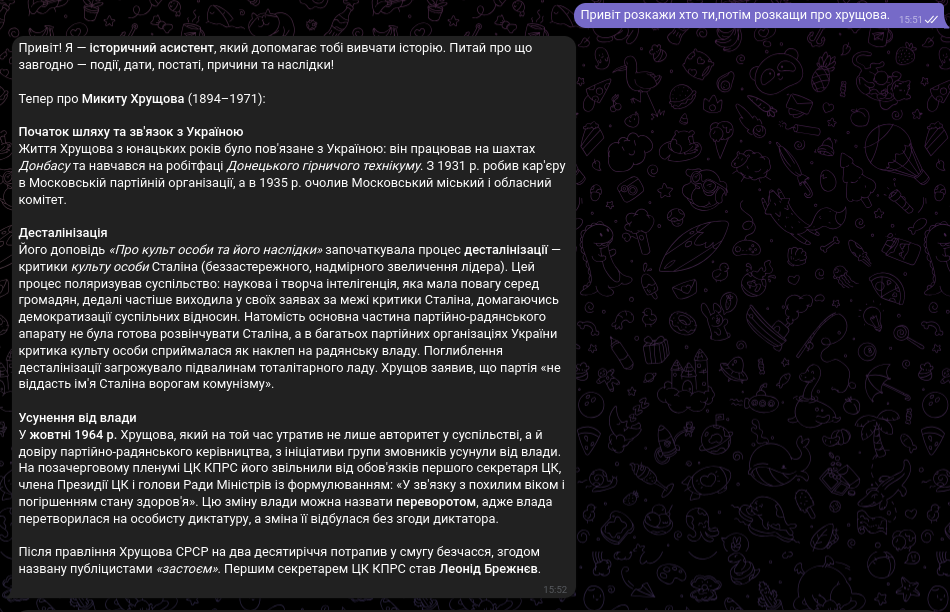

RAG HistoryAgent 🇺🇦

An AI-powered Ukrainian history assistant built with Retrieval-Augmented Generation (RAG).

RAG HistoryAgent is an AI assistant designed to help students explore Ukrainian history through natural-language questions. It retrieves relevant historical information from a knowledge base and uses a large language model (LLM) to generate contextual answers.

The project combines semantic search, keyword-based retrieval, hybrid search, and reranking to improve the relevance of retrieved historical documents.
Features

    Retrieval-Augmented Generation (RAG) — generates answers grounded in retrieved historical context.

    Multilingual embeddings — uses multilingual-e5-large for semantic retrieval across multilingual text.

    Hybrid search — combines dense vector retrieval with BM25 keyword search.

    Reranking — refines retrieved results to prioritize the most relevant passages.

    Vector database — uses Qdrant to store and retrieve historical document embeddings.

    LLM integration — supports locally hosted language models through LM Studio.

    Ukrainian-language focus — designed for questions about Ukrainian history and educational use.

## Demo

