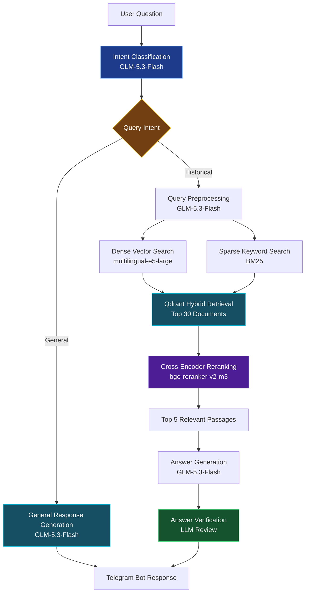

# 🇺🇦 RAG HistoryAgent

<p align="center">  
<strong>An AI-powered assistant for exploring Ukrainian history.</strong>  
<br />  
Retrieval-Augmented Generation · Hybrid Search · Reranking  
</p>

<p align="center">  
  
  
  
  
</p>

----------

## Overview

**RAG HistoryAgent** is an AI assistant designed to help students explore Ukrainian history through natural-language questions.

The system retrieves relevant historical passages from a knowledge base and uses a large language model (LLM) to generate contextual answers grounded in the retrieved information.

Rather than relying solely on the language model's internal knowledge, the project combines semantic retrieval, keyword-based search, hybrid ranking, and reranking to improve the relevance of the context supplied to the model.

## Demo

<p align="center">  
  
</p>

<p align="center">  
<em>Exploring Ukrainian history through natural-language questions.</em>  
</p>

## Key Features

-   **Retrieval-Augmented Generation** — generates answers using relevant historical context retrieved from the knowledge base.
    
-   **Multilingual Semantic Search** — uses `multilingual-e5-large` to represent documents and queries as dense embeddings.
    
-   **Hybrid Retrieval** — combines dense vector search with BM25 keyword retrieval to capture both semantic meaning and exact terminology.
    
-   **Reranking** — refines the initial retrieval results to prioritize passages most relevant to the user's question.
    
-   **Vector Database** — uses Qdrant to store and retrieve document embeddings.
    
-   **Local LLM Inference** — integrates with LM Studio to run supported language models locally.
    
-   **Educational Focus** — provides a conversational interface for exploring Ukrainian history.
    

## Architecture



The pipeline combines dense semantic search and sparse BM25 retrieval using Qdrant's hybrid search. A cross-encoder reranks the retrieved candidates, selecting the five most relevant passages for answer generation. The generated answer is then reviewed by a second LLM call to identify and correct claims unsupported by the retrieved context before being returned through Telegram.
## Tech Stack

 - Python    
 - LangChain      
 - Embeddings
			            `multilingual-e5-large`
  
 - Qdrant      
 - BM25
 - aiogram

## Getting Started

### Prerequisites

-   Python
    
-   [uv](https://docs.astral.sh/uv/)
    
-   A running Qdrant instance with the required collection and indexed documents
    
-   [LM Studio](https://lmstudio.ai/) with a compatible model loaded and its local API enabled
    

### Installation

Clone the repository:

```
git clone https://github.com/water980/histagent
cd histagent
```

Install the project dependencies:

```
uv sync
```

### Configuration

Create a `.env` file and configure the environment variables required by the application.

Keep API keys and other secrets out of version control.

### Run the Application


```
chmod +x start_qdrant.sh 
./start_qdrant.sh # start qdrant using docker
chmod +x prepare_book.sh
./prepare_book.sh  # preparing book using scripts
uv run python main.py # run the application
```

Adjust the command to match your actual project structure.

## Project Goals

RAG HistoryAgent explores how modern retrieval techniques can improve the usefulness of LLM-based educational applications, particularly when answering domain-specific questions in Ukrainian.

The project brings together semantic search, lexical retrieval, reranking, vector storage, and local language model inference in a single application.
